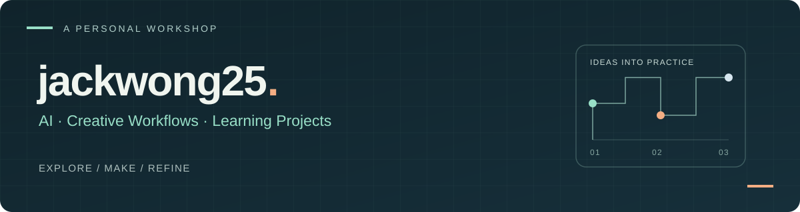

<a href="https://github.com/jackwong25">中文</a> · <strong>English</strong>

Hi, I'm **jackwong25**.

This is a home for my experiments and projects in **AI tools, creative workflows, and learning products**. I aim to turn ideas into useful work and tools, then improve them through actual use.

  <a href="#projects">Projects</a> ·
  <a href="#learning--references">Learning & references</a> ·
  <a href="https://github.com/jackwong25?tab=repositories">All public repositories</a>

## Areas of interest

- **AI & workflows** — Explore agents, skills, and automation for concrete tasks.
- **Content & visuals** — Experiment with writing, image art direction, and video tools.
- **Learning & products** — Turn learning topics and everyday needs into practical projects.

## Projects

| Project | What you'll find |
| --- | --- |
| [**Odyssey Summer Lab**](https://github.com/jackwong25/odyssey-summer-lab) | A Mars-themed project-based learning app for the transition from primary to junior middle school. The public repository contains code and project documentation, with an [earlier concept preview](https://github.com/jackwong25/odyssey-summer-lab-preview) in a separate repository. |
| [**ME App**](https://github.com/jackwong25/me-app) | A product exploration around daily philosophical reflection, dialogue, and personal notes. The repository holds requirements, design, and development materials. |
| [**2026 Fat Burning Season**](https://github.com/jackwong25/ranzhi-2026) | Documents outlining a multi-party commercial collaboration for a healthy weight management program. |
| [**Maugham Perspective**](https://github.com/jackwong25/maugham-perspective) | A Maugham-inspired writing and thinking skill for Hermes Agent. The repository retains credits for its generation framework and creator. |

## Learning & references

These selected **forks** are learning and experimentation references. See each repository for its upstream source, author credits, and license.

| Reference | Focus |
| --- | --- |
| [sweety-image-art-direction](https://github.com/jackwong25/sweety-image-art-direction) | Image art direction, reference management, and output review |
| [erduo-broll-loop-engineering](https://github.com/jackwong25/erduo-broll-loop-engineering) | Subtitle-driven B-roll video workflows |
| [craft-skills](https://github.com/jackwong25/craft-skills) | Research-backed, evaluation-driven agent skills |

Earlier resources

The [2023 GPT-4 resource guide](archive/gpt4-guide-2023.md) is archived unchanged. Product details, pricing, and instructions may be outdated.

---

Questions and suggestions are welcome in the relevant project's **Issues**.
